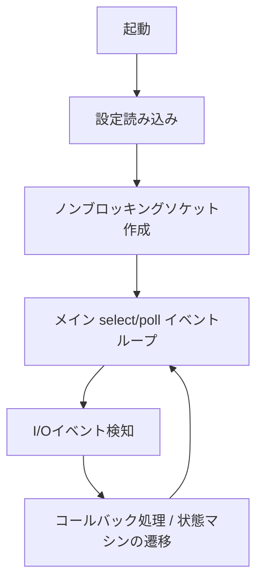
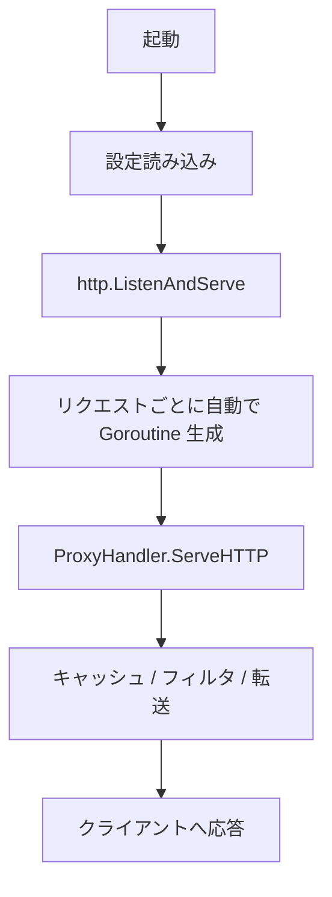

# ARCHITECTURE & FILE MAPPING

(For the English version, see ARCHITECTURE.md / 英語版は ARCHITECTURE.md を参照してください)

C言語版の Polipo (1.1.1) と Go言語版 (v2.0.0) における各ソースファイルの関連性および機能のマッピングです。
Go言語版は、並行処理 (Goroutines) や標準ライブラリの利点を活かし、大幅なシンプル化と安全性の向上を図っています。

元の C 言語ソースは v2.0.0 で削除済みです。本ドキュメントは移行の経緯と設計判断の記録として残しています。

## ファイル対応表

| C言語ソースファイル | Go言語ソースファイル | 役割と移行内容の概要 |
| :--- | :--- | :--- |
| `auth.c` | `proxy.go` / *(Go標準 `encoding/base64`)* | **認証処理** Basic認証やプロキシ認証情報のパース・生成は、Go標準ライブラリ（`encoding/base64` や `http.Header`）及び `proxy.go` にて処理されるため個別ファイルは不要。 |
| `atom.c` `chunk.c` `object.c` | *(メモリ管理 / ガベージコレクション)* | **メモリ管理** メモリ上のオブジェクトやチャンク、文字列アトムテーブル・参照カウントなどの管理は、Goの標準マップや文字列型、ガベージコレクション (GC) に任せるため不要。 |
| `client.c` `http.c` `http_parse.c` `server.c` `tunnel.c` | `proxy.go` | **プロキシサーバーコア** HTTPフォワード、`CONNECT` によるHTTPSトンネリングなどのプロキシ処理をGoの `http.Handler` および `http.Transport` に集約・再設計。コネクションの再利用・多重化・パイプライン化（旧`serverSlots*`/`smallRequestTime`/`replyUnpipeline*`/`maxPipelineTrain`/`maxSideBuffering`/`serverExpireTime`）は`http.Transport`に一任し、設定では調整不可の固定値（`MaxIdleConns: 100`、`IdleConnTimeout: 90s`）になっている。Poor Man's Multiplexing（1つの大きな取得を複数の上流接続に分割する機能）に相当する仕組みは無く、`net/http`は1リソースを常に単一のコネクションで取得する。 |
| `config.c` | `config.go` | **設定ファイルのパース** Polipo 形式の設定ファイル（`key = value`）を読み込み、構造体 `Config` へパースして管理。 |
| `diskcache.c` | `cache.go` | **キャッシュ管理** Polipo のディレクトリ階層およびファイル名（URLのMD5ハッシュ値をカスタムBase64エンコード）と完全に互換性のあるディスクキャッシュの読み書き。`CacheManager.Expire`（`-x` オプション）でキャッシュツリーを走査し、破損・鮮度切れ・長期未アクセス（`diskCacheUnlinkTime`）のエントリ削除と空ディレクトリの整理を行う。書き込みポリシーは Polipo より厳格で、`Set-Cookie` を含む応答は既定でスキップ（`dontCacheCookies`）、`Authorization` / `Proxy-Authorization` 付きリクエストの応答は明示的に共有可能でない限りスキップ（RFC 9111 §3.5）、ディスクキャッシュ自体の無効化も可能（`noDiskCache`、または空の `diskCacheRoot`）。 |
| `dns.c` | *(Go標準 `net.Resolver`)* | **DNS解決** Goの標準ライブラリ `net.Resolver` に委ねられるため、非同期DNS処理や独自のDNSキャッシュの実装は不要。 |
| `event.c` | *(Goroutines / 標準ライブラリ)* | **イベントループ** C言語版のシングルスレッド・ノンブロッキングイベントループは、Goの Goroutine や `net/http` が提供する並行接続処理に置き換えられたため不要。 |
| `dirent_compat.c` `fts_compat.c` `ftsimport.c` `mingw.c` | *(Go標準 `os` / `path/filepath`)* | **OS互換性レイヤー / ディレクトリ巡回** Windows/POSIX互換、ディレクトリ巡回用のコードは、Goが言語レベルでクロスプラットフォームに抽象化しているため不要。 |
| `forbidden.c` | `forbidden.go` | **アクセス制限フィルタ** 禁止URLリストの読み込み。ドメインの後方一致および正規表現マッチングによるアクセス可否判定。 |
| `io.c` | *(Go標準 `net` / `bufio`)* | **ソケットI/O制御** ソケットバッファリングやタイムアウトなどの非同期I/O制御は、Goの標準ライブラリ（`net.Conn`, `bufio` 等）と Goroutine が自動的に行うため、独自の I/O レイヤーは不要。 |
| `local.c` | `proxy.go` | **ローカルWebインターフェース** `local.c` の設定変数表示や動的設定などのローカルWebインターフェース（`/polipo/`, `/polipo/config`）は、`proxy.go` 内の `handleLocal` メソッドにて簡略化して再実装・統合。 |
| `log.c` | *(Go標準 `log`)* | **ロギング** Go標準の `log` パッケージを利用して簡略化。`logLevel` はパースして保持するだけで出力を絞り込まない — Polipo の `logLevel` はエラー・警告・禁止リストによる拒否・トンネル動作などの独立したメッセージ種別を表すビットマスクであり、Go標準の `log` パッケージにはそれに対応する「レベル」という概念自体が無いため、すべての呼び出し箇所が無条件に出力する。`logSyslog`/`logFacility` に相当するものは無く、syslog への出力先も無い。 |
| `main.c` | `main.go` | **エントリーポイント** コマンドライン引数（`-c`, `-v`, `-x` 等）の解析と、HTTPプロキシサーバーの初期化・起動処理。デーモン化そのもの（`daemonise`、`pidFile`）は再実装しておらず、go-polipo をバックグラウンドサービスとして動かすことはOS側の仕組み（Unixではサービスマネージャ、WindowsではインストーラーのTaskSchedulerエントリ）に委ねている。 |
| `md5.c` `md5import.c` | *(Go標準 `crypto/md5`)* | **ハッシュ計算** C言語用の MD5 インポートファイルは不要となり、標準ライブラリ `crypto/md5` を直接利用するため不要。 |
| `parse_time.c` | *(Go標準 `time` / `net/http`)* | **日時パース** HTTP日時文字列のパースは、Go標準ライブラリの `time.Parse` や `http.ParseTime` に置き換えられたため不要。 |
| `socks.c` | `proxy.go` | **SOCKS親子プロキシ** `socks.c` の親SOCKSプロキシ経由の接続処理は、`proxy.go` 内の `dialContext` にて `golang.org/x/net/proxy` を利用して実装・統合。 |
| `util.c` | `cache.go` (一部統合) | **ユーティリティ** C言語版の `b64cpy` 等のカスタムBase64エンコーディングロジックを `cache.go` 内の `b64fss` を用いた処理に統合。 |

---

## ライフサイクルとスレッドモデルの比較

### C言語版 Polipo (シングルスレッド)

### Go言語版 go-polipo (マルチスレッド / Goroutine)

