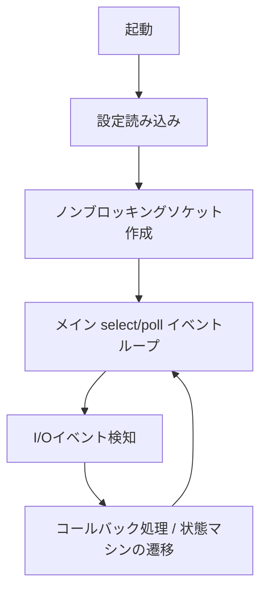
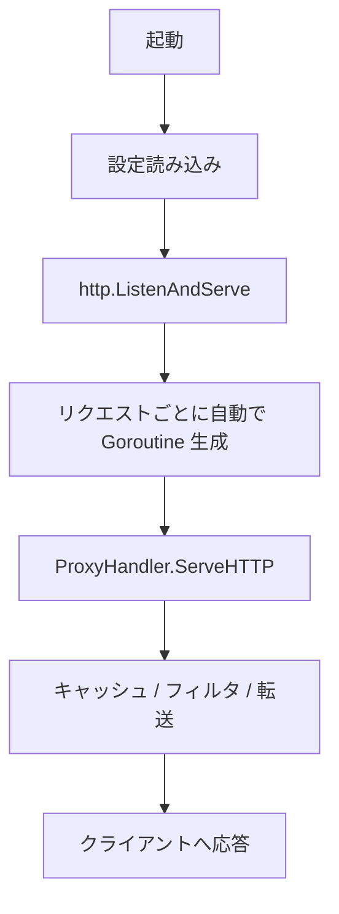
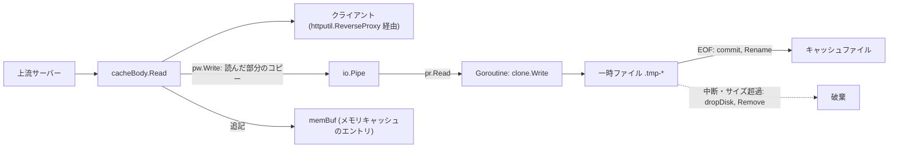

# ARCHITECTURE & FILE MAPPING

(For the English version, see ARCHITECTURE.md / 英語版は ARCHITECTURE.md を参照してください)

C言語版の Polipo (1.1.1) と Go言語版 (v2.0.0) における各ソースファイルの関連性および機能のマッピングです。
Go言語版は、並行処理 (Goroutines) や標準ライブラリの利点を活かし、大幅なシンプル化と安全性の向上を図っています。

元の C 言語ソースは v2.0.0 で削除済みです。本ドキュメントは移行の経緯と設計判断の記録として残しています。

## ファイル対応表

| C言語ソースファイル | Go言語ソースファイル | 役割と移行内容の概要 |
| :--- | :--- | :--- |
| `auth.c` | `proxy.go` / *(Go標準 `encoding/base64`)* | **認証処理** Basic認証やプロキシ認証情報のパース・生成は、Go標準ライブラリ（`encoding/base64` や `http.Header`）及び `proxy.go` にて処理されるため個別ファイルは不要。 |
| `atom.c` `chunk.c` `object.c` | *(メモリ管理 / ガベージコレクション)* | **メモリ管理** メモリ上のオブジェクトやチャンク、文字列アトムテーブル・参照カウントなどの管理は、Goの標準マップや文字列型、ガベージコレクション (GC) に任せるため不要。 |
| `client.c` `http.c` `http_parse.c` `server.c` `tunnel.c` | `proxy.go` `parent_tunnel.go` | **プロキシサーバーコア** HTTPフォワード、`CONNECT` によるHTTPSトンネリングなどのプロキシ処理をGoの `http.Handler` および `http.Transport` に集約・再設計。コネクションの再利用・多重化・パイプライン化（旧`serverSlots*`/`smallRequestTime`/`replyUnpipeline*`/`maxPipelineTrain`/`maxSideBuffering`/`serverExpireTime`）は`http.Transport`に一任し、`MaxIdleConns: 100` の固定値になっている。設定で変えられるのは、Polipo と同じタイムアウト（`clientTimeout`・`serverTimeout`・`serverIdleTimeout`）と、go-polipo 独自の CONNECT トンネル用の `tunnelIdleTimeout`（既定は無効）だけ。Poor Man's Multiplexing（1つの大きな取得を複数の上流接続に分割する機能）に相当する仕組みは無く、`net/http`は1リソースを常に単一のコネクションで取得する。HTTP の親プロキシがあるときは、`tunnel.c` と同じく親に `CONNECT host:port` を送って CONNECT トンネルを開く（`parent_tunnel.go`）。 |
| `config.c` | `config.go` | **設定ファイルのパース** Polipo 形式の設定ファイル（`key = value`）を読み込み、構造体 `Config` へパースして管理。 |
| `diskcache.c` | `cache.go` | **キャッシュ管理** Polipo のディレクトリ階層およびファイル名（URLのMD5ハッシュ値をカスタムBase64エンコード）と完全に互換性のあるディスクキャッシュの読み書き。`CacheManager.Expire`（`-x` オプション）でキャッシュツリーを走査し、破損・鮮度切れ・長期未アクセス（`diskCacheUnlinkTime`）のエントリ削除と空ディレクトリの整理を行う。書き込みポリシーは Polipo より厳格で、`Set-Cookie` を含む応答は既定でスキップ（`dontCacheCookies`）、`Authorization` 付きリクエストの応答は明示的に共有可能でない限りスキップ（RFC 9111 §3.5。`Proxy-Authorization` は go-polipo 自身へのクライアント認証で、上流へは転送されず、保存を妨げない）、ディスクキャッシュ自体の無効化も可能（`noDiskCache`、または空の `diskCacheRoot`）。 |
| `dns.c` | *(Go標準 `net.Resolver`)* | **DNS解決** Goの標準ライブラリ `net.Resolver` に委ねられるため、非同期DNS処理や独自のDNSキャッシュの実装は不要。 |
| `event.c` | *(Goroutines / 標準ライブラリ)* | **イベントループ** C言語版のシングルスレッド・ノンブロッキングイベントループは、Goの Goroutine や `net/http` が提供する並行接続処理に置き換えられたため不要。 |
| `dirent_compat.c` `fts_compat.c` `ftsimport.c` `mingw.c` | *(Go標準 `os` / `path/filepath`)* | **OS互換性レイヤー / ディレクトリ巡回** Windows/POSIX互換、ディレクトリ巡回用のコードは、Goが言語レベルでクロスプラットフォームに抽象化しているため不要。 |
| `forbidden.c` | `forbidden.go` `destination.go` | **アクセス制限フィルタ** 禁止URLリストの読み込み。ドメインの後方一致および正規表現マッチングによるアクセス可否判定。`destination.go` は Polipo に対応するものが無く、このマシンやそのリンクのアドレス、設定によってはプライベートアドレスへの接続を拒否する（`forbidLocalDestinations`、`forbidPrivateDestinations`）。判定は `net.Dialer` の `Control` 関数で行うので、名前解決した後に実際に接続するアドレスを見る。 |
| `io.c` | *(Go標準 `net` / `bufio`)* | **ソケットI/O制御** ソケットバッファリングやタイムアウトなどの非同期I/O制御は、Goの標準ライブラリ（`net.Conn`, `bufio` 等）と Goroutine が自動的に行うため、独自の I/O レイヤーは不要。 |
| `local.c` | `proxy.go` | **ローカルWebインターフェース** `local.c` の設定変数表示や動的設定などのローカルWebインターフェース（`/polipo/`, `/polipo/config`）は、`proxy.go` 内の `handleLocal` メソッドにて簡略化して再実装・統合。状態表示（`/polipo/status`）は `stats.go` が描画し、プロキシがリクエストを処理しながら更新するトラフィックの統計もここで保持する。Polipo と違い、go-polipo 自身に宛てたリクエストは Host がこのマシンを指していなければならず（`isLocalHostAllowed`）、ほかのサイトからの POST は拒否する（`http.CrossOriginProtection`）。 |
| `log.c` | *(Go標準 `log`)* / `logging.go` | **ロギング** Go標準の `log` パッケージを利用して簡略化。`logLevel` はPolipo自身と同じ、エラー・警告・情報・ポリシーによる拒否という独立したメッセージ種別を表すビットマスクであり、順序付きの重大度しきい値ではない — `logging.go` の `logf` が各呼び出し箇所をカテゴリビットで判定する（Go標準の `log` パッケージにはそれに対応する「レベル」という概念自体が無いため、自前で実装）。`logSyslog`/`logFacility` に相当するものは今も無く、syslog への出力先も無い。 |
| `main.c` | `main.go` | **エントリーポイント** コマンドライン引数（`-c`, `-v`, `-x` 等）の解析と、HTTPプロキシサーバーの初期化・起動処理。デーモン化そのもの（`daemonise`、`pidFile`）は再実装しておらず、go-polipo をバックグラウンドサービスとして動かすことはOS側の仕組み（Unixではサービスマネージャ、WindowsではインストーラーのTaskSchedulerエントリ）に委ねている。 |
| `md5.c` `md5import.c` | *(Go標準 `crypto/md5`)* | **ハッシュ計算** C言語用の MD5 インポートファイルは不要となり、標準ライブラリ `crypto/md5` を直接利用するため不要。 |
| `parse_time.c` | *(Go標準 `time` / `net/http`)* | **日時パース** HTTP日時文字列のパースは、Go標準ライブラリの `time.Parse` や `http.ParseTime` に置き換えられたため不要。 |
| `socks.c` | `proxy.go` | **SOCKS親子プロキシ** `socks.c` の親SOCKSプロキシ経由の接続処理は、`proxy.go` 内の `dialContext` にて `golang.org/x/net/proxy` を利用して実装・統合。 |
| `util.c` | `cache.go` (一部統合) | **ユーティリティ** C言語版の `b64cpy` 等のカスタムBase64エンコーディングロジックを `cache.go` 内の `b64fss` を用いた処理に統合。 |

---

## ライフサイクルとスレッドモデルの比較

### C言語版 Polipo (シングルスレッド)

### Go言語版 go-polipo (マルチスレッド / Goroutine)

### go-polipo が自分で起動する Goroutine

`net/http` がリクエストごとに起動する Goroutine のほかに、go-polipo は自分の `go` 文で次の Goroutine を起動します。

| 起動している関数 | 役割 | 終わるとき | 失敗の伝え方 |
|---|---|---|---|
| `CacheManager.startDiskWrite` (cache.go) | レスポンスの本文を返しながら、ディスクキャッシュのファイルに書き込む | 本文を書き終えたとき、または書き込みが止まったとき | `diskWrite.done` チャネルで `error` を送る |
| `serve` (main.go) | `SIGINT` / `SIGTERM` を待ち、サーバーを閉じる | どちらかのシグナルを受けたとき | 不要 (終了をログに出す) |
| `setupReloadSignals` (signal_unix.go。Windows にはない) | `SIGUSR1` / `SIGUSR2` を受けて、ログファイルを開き直し、forbidden / uncachable / forbiddenTunnels の各リストを読み直す (`SIGUSR2` ではメモリキャッシュも捨てる) | 終わらない (プロセスが動いている間ずっと続く) | 失敗をそのつどログに出し、待ち受けを続ける |
| `tunnel` (proxy.go) の 2 つ | CONNECT トンネルを片方向ずつコピーする | その方向が EOF またはエラーになったとき | 不要 (`tunnel` が `sync.WaitGroup` で両方の終了を待つ) |
| `tunnelWithIdleTimeout` (proxy.go) | トンネルを `tunnelIdleTimeout` で監視し、時間切れになったら両方の接続を閉じる | トンネルが終わったとき、またはタイムアウトしたとき | 関数の戻り値になる `expired` フラグを立てる |

どの Goroutine も `recover` しません。起こりうる失敗は `error` で返します。panic はバグを意味し、どの Goroutine でも `recover` されない panic はプロセス全体を止めます。panic の内容とスタックトレースは標準エラー出力に出ます (`logFile` には出ません)。これは意図した動きです。バグのあとも動き続けるとキャッシュが壊れた状態になりかねない一方、同梱の `systemd/go-polipo.service` はプロセスを再起動します (`Restart=on-failure`)。リクエストを処理するハンドラー自身での panic は別で、`net/http` が接続ごとに `recover` し、`http: panic serving ...` を標準ロガーに出します。標準ロガーの出力先は、`logFile` を設定していればそのファイルです。クライアントとの接続も `net/http` が閉じますが、CONNECT ハンドラーが接続を乗っ取った (Hijack した) あとは閉じません。その場合は、panic の巻き戻しの途中で実行されるハンドラー自身の `defer` の `Close` が、両方の接続を閉じます。これが当てはまるのはハンドラーの Goroutine だけで、`tunnel` が起動する 2 つのコピー用 Goroutine は含みません。

## レスポンスをキャッシュに保存する流れ

`ProxyHandler.cacheResponse` は、各レスポンスを `CacheManager.Store` に渡します。キャッシュしてよいレスポンスなら、`Store` は本文を `cacheBody` に差し替えます。`cacheBody` は、クライアントが本文を受け取るのと同時に、本文をキャッシュへコピーします。クライアントより先に本文を読み進めることはありません。`httputil.ReverseProxy` がクライアントのために読んだ部分は、そのたびにディスクのエントリ、メモリのエントリ、またはその両方にも送られます。

`httputil.ReverseProxy` は名前に反して、標準ライブラリの汎用の転送部品にすぎません。リクエストを受け取って先へ送り、レスポンスを中継します。go-polipo はフォワードプロキシーで、この部品をフォワードプロキシーとして使っています。クライアントがプロキシーに送るリクエストには最初から完全な URL が入っているので、`Rewrite` フック（`ProxyHandler.rewrite`）は転送先を後ろのサーバーに書き換えず、そのままにします。

- **パイプを使う理由。** ディスクのエントリは、レスポンスを HTTP の形のまま書いたものです (ステータス行、go-polipo の `X-Polipo-*` メタデータを含むヘッダー、本文)。`startDiskWrite` はこれを `http.Response.Write` で書き出します。`Response.Write` は、本文を EOF まで自分で読みに行く関数です。一方、本文はクライアントが読み進めるのに合わせて、少しずつキャッシュへ渡されてきます。この 2 つをつなぐのが `io.Pipe` です。`cacheBody.Read` が `pw` に書いたものが `pr` から出てきて、それを別の Goroutine の `Response.Write` が読みます (本文が終わるまで戻らないため、別の Goroutine で動かします)。こうすることで、本文全体をメモリに持たずに済みます。
- **パイプにはバッファーがない。** `pw.Write` は、Goroutine がバイト列を受け取るまで戻りません。そのため、ディスクへの書き込みはクライアントへの送信と同じ速さで進みます。ディスクが極端に遅いとクライアントへの送信も遅くなりますが、レスポンスが大きくてもメモリの使用量は増えません。
- **確定 (commit)。** 本文が EOF に達すると、`commit` が `pw` を閉じ、`diskWrite.done` で Goroutine の結果を待ってから、一時ファイルを本来の名前に変えます。でき上がったメモリのエントリも、このとき LRU キャッシュに加えます。
- **中断 (abort)。** 本文が EOF の前に失敗したり閉じられたりしたとき、または `maxDiskCacheEntrySize` を超えたときは、`dropDisk` が `pw` をエラー付きで閉じ、Goroutine を待ってから一時ファイルを消します。そのため、途中までのエントリがキャッシュファイルの名前で現れることはありません (`memoryCacheMaxEntrySize` を超えたときは、メモリのエントリだけを捨てます)。逆にディスクへの書き込みが失敗したときは、Goroutine が `pr` をエラー付きで閉じます。そうすると次の `pw.Write` がエラーを返すので、待ったまま止まることはありません。
