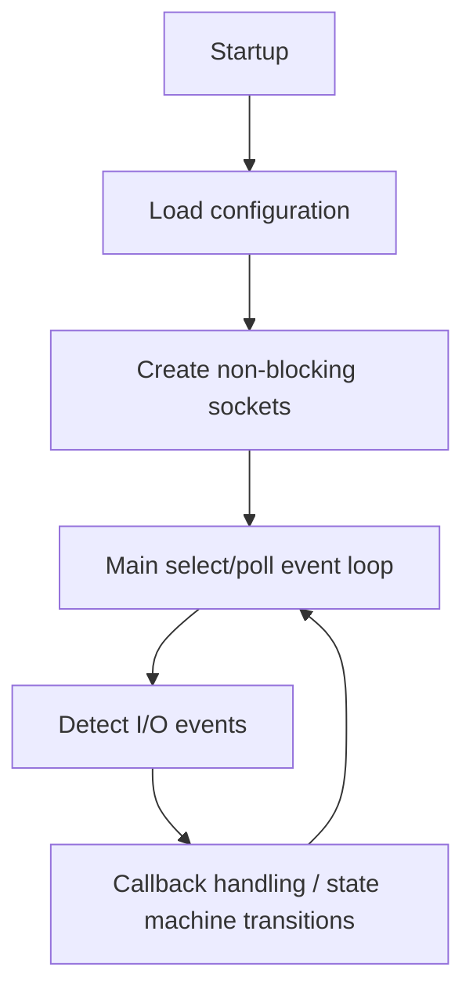
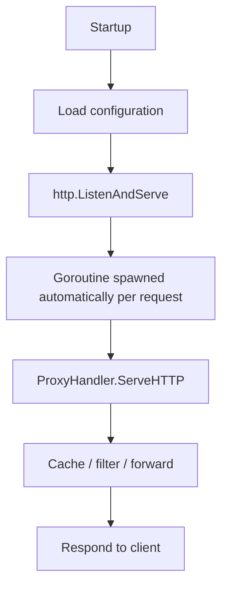

# ARCHITECTURE & FILE MAPPING

(日本語版は ARCHITECTURE.ja.md を参照してください / A Japanese version is available in ARCHITECTURE.ja.md)

This maps each source file of the original C Polipo (1.1.1) to its Go (v2.0.0)
counterpart, and summarizes how the corresponding functionality moved over.
The Go rewrite leans on goroutines and the standard library to achieve a
large simplification and improved memory safety compared to the C version.

The original C sources were removed in v2.0.0. This document remains as a
record of the migration and the design decisions behind it.

## File mapping

| C source file | Go source file | Role and migration notes |
| :--- | :--- | :--- |
| `auth.c` | `proxy.go` / *(Go standard `encoding/base64`)* | **Authentication** Parsing and generating Basic auth / proxy credentials is handled by the Go standard library (`encoding/base64`, `http.Header`) and `proxy.go`, so a dedicated file is unnecessary. |
| `atom.c` `chunk.c` `object.c` | *(memory management / garbage collection)* | **Memory management** Managing in-memory objects, chunks, and the string atom table with reference counting is left to Go's standard maps, string type, and garbage collector, so these are unnecessary. |
| `client.c` `http.c` `http_parse.c` `server.c` `tunnel.c` | `proxy.go` | **Proxy server core** HTTP forwarding and `CONNECT`-based HTTPS tunnelling are consolidated and redesigned around Go's `http.Handler` and `http.Transport`. Connection reuse, multiplexing, and pipelining (previously the `serverSlots*`/`smallRequestTime`/`replyUnpipeline*`/`maxPipelineTrain`/`maxSideBuffering`/`serverExpireTime` knobs) are `http.Transport`'s responsibility now, with a fixed `MaxIdleConns: 100`; only the timeouts are configurable (`clientTimeout`, `serverTimeout`, `serverIdleTimeout`, as in Polipo). Poor Man's Multiplexing (splitting one large fetch across several upstream connections) has no equivalent; `net/http` fetches a resource over a single connection. |
| `config.c` | `config.go` | **Configuration file parsing** Reads Polipo-format configuration files (`key = value`) and parses them into the `Config` struct. |
| `diskcache.c` | `cache.go` | **Cache management** Reads and writes an on-disk cache fully compatible with Polipo's directory layout and file naming (URL MD5 hash, custom base64-encoded). `CacheManager.Expire` (the `-x` option) walks the cache tree and removes corrupt, stale, and long-untouched (`diskCacheUnlinkTime`) entries, pruning empty directories. The write policy is stricter than Polipo's: responses with `Set-Cookie` are skipped by default (`dontCacheCookies`), responses to `Authorization` requests are skipped unless explicitly shareable (RFC 9111 §3.5; `Proxy-Authorization` only authenticates the client to go-polipo, is not forwarded, and does not prevent caching), and the disk cache can be turned off entirely (`noDiskCache`, or an empty `diskCacheRoot`). |
| `dns.c` | *(Go standard `net.Resolver`)* | **DNS resolution** Delegated to the Go standard library's `net.Resolver`, so asynchronous DNS handling and a custom DNS cache are unnecessary. |
| `event.c` | *(goroutines / standard library)* | **Event loop** The C version's single-threaded, non-blocking event loop is replaced by goroutines and the concurrent connection handling `net/http` provides, so it is unnecessary. |
| `dirent_compat.c` `fts_compat.c` `ftsimport.c` `mingw.c` | *(Go standard `os` / `path/filepath`)* | **OS compatibility layer / directory traversal** Windows/POSIX compatibility and directory-traversal code are unnecessary because Go abstracts cross-platform concerns at the language level. |
| `forbidden.c` | `forbidden.go` `destination.go` | **Access restriction filter** Loads the forbidden-URL list and decides access based on domain suffix matching and regular expressions. `destination.go` has no Polipo counterpart: it refuses connections to addresses on this machine or its link, and optionally to private addresses (`forbidLocalDestinations`, `forbidPrivateDestinations`). The check is a `net.Dialer` `Control` function, so it sees the address actually dialled after DNS resolution. |
| `io.c` | *(Go standard `net` / `bufio`)* | **Socket I/O control** Socket buffering and timeout handling are done automatically by the Go standard library (`net.Conn`, `bufio`, etc.) and goroutines, so a custom I/O layer is unnecessary. |
| `local.c` | `proxy.go` | **Local web interface** The configuration-variable display and dynamic configuration served by `local.c` (`/polipo/`, `/polipo/config`) are reimplemented in a simplified, consolidated form in the `handleLocal` method of `proxy.go`. The status report (`/polipo/status`) is rendered by `stats.go`, which keeps the traffic counters the proxy updates as it handles requests. Unlike Polipo, a request addressed to go-polipo itself must name this machine in its Host (`localHostAllowed`), and a cross-site POST is refused (`http.CrossOriginProtection`). |
| `log.c` | *(Go standard `log`)* / `logging.go` | **Logging** Simplified by using the Go standard `log` package. `logLevel` is a bitmask of independent message categories, matching Polipo's own (errors, warnings, informational messages, policy denials) rather than an ordered severity threshold; `logging.go`'s `logf` gates each call site on its category bit, hand-rolled since the standard `log` package has no built-in notion of levels to map that onto. `logSyslog`/`logFacility` still have no equivalent; there is no syslog sink. |
| `main.c` | `main.go` | **Entry point** Parses command-line arguments (`-c`, `-v`, `-x`, etc.) and initializes and starts the HTTP proxy server. Backgrounding itself (`daemonise`, `pidFile`) is not reimplemented; running go-polipo as a background service is left to the OS's own tooling (a service manager on Unix, the Windows installer's Task Scheduler entry on Windows). |
| `md5.c` `md5import.c` | *(Go standard `crypto/md5`)* | **Hash computation** The C-specific MD5 import files are unnecessary since the standard library's `crypto/md5` is used directly. |
| `parse_time.c` | *(Go standard `time` / `net/http`)* | **Date/time parsing** HTTP date-string parsing is replaced by the Go standard library's `time.Parse` and `http.ParseTime`. |
| `socks.c` | `proxy.go` | **SOCKS parent proxy** Connecting through a parent SOCKS proxy, previously in `socks.c`, is implemented and consolidated in `dialContext` in `proxy.go` using `golang.org/x/net/proxy`. |
| `util.c` | `cache.go` (partially consolidated) | **Utilities** The C version's custom base64 encoding logic (e.g. `b64cpy`) is consolidated into the `b64fss`-based handling in `cache.go`. |

---

## Lifecycle and threading model comparison

### C Polipo (single-threaded)

### Go go-polipo (multi-threaded / goroutines)

