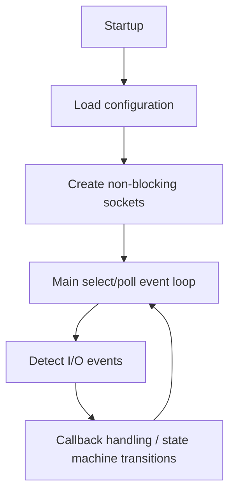
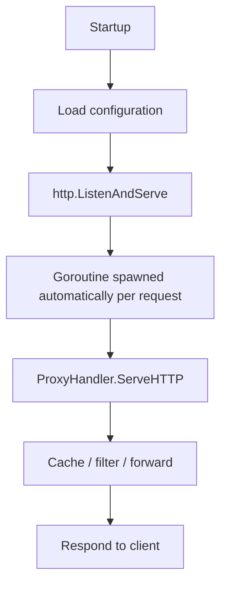
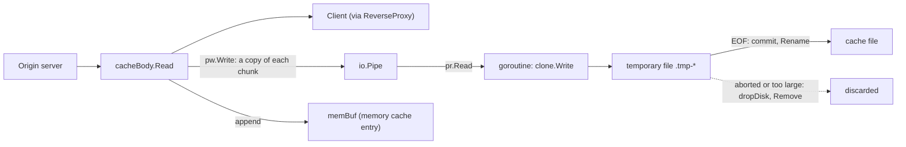

# ARCHITECTURE & FILE MAPPING

(日本語版は ARCHITECTURE.ja.md を参照してください / A Japanese version is available in ARCHITECTURE.ja.md)

This maps each source file of the original C Polipo (1.1.1) to its Go (v2.0.0)
counterpart, and summarizes how the corresponding functionality moved over.
The Go rewrite leans on goroutines and the standard library to achieve a
large simplification and improved memory safety compared to the C version.

The original C sources were removed in v2.0.0. This document remains as a
record of the migration and the design decisions behind it.

## File mapping

| C source file | Go source file | Role and migration notes |
| :--- | :--- | :--- |
| `auth.c` | `proxy.go` / *(Go standard `encoding/base64`)* | **Authentication** Parsing and generating Basic auth / proxy credentials is handled by the Go standard library (`encoding/base64`, `http.Header`) and `proxy.go`, so a dedicated file is unnecessary. |
| `atom.c` `chunk.c` `object.c` | *(memory management / garbage collection)* | **Memory management** Managing in-memory objects, chunks, and the string atom table with reference counting is left to Go's standard maps, string type, and garbage collector, so these are unnecessary. |
| `client.c` `http.c` `http_parse.c` `server.c` `tunnel.c` | `proxy.go` `parent_tunnel.go` | **Proxy server core** HTTP forwarding and `CONNECT`-based HTTPS tunnelling are consolidated and redesigned around Go's `http.Handler` and `http.Transport`. Connection reuse, multiplexing, and pipelining (previously the `serverSlots*`/`smallRequestTime`/`replyUnpipeline*`/`maxPipelineTrain`/`maxSideBuffering`/`serverExpireTime` knobs) are `http.Transport`'s responsibility now, with a fixed `MaxIdleConns: 100`; only the timeouts are configurable (`clientTimeout`, `serverTimeout`, `serverIdleTimeout`, as in Polipo, plus go-polipo's own `tunnelIdleTimeout` for CONNECT tunnels, off by default). Poor Man's Multiplexing (splitting one large fetch across several upstream connections) has no equivalent; `net/http` fetches a resource over a single connection. With an HTTP parent proxy, a CONNECT tunnel is opened by sending the parent `CONNECT host:port`, as in `tunnel.c` (`parent_tunnel.go`). |
| `config.c` | `config.go` | **Configuration file parsing** Reads Polipo-format configuration files (`key = value`) and parses them into the `Config` struct. |
| `diskcache.c` | `cache.go` | **Cache management** Reads and writes an on-disk cache fully compatible with Polipo's directory layout and file naming (URL MD5 hash, custom base64-encoded). `CacheManager.Expire` (the `-x` option) walks the cache tree and removes corrupt, stale, and long-untouched (`diskCacheUnlinkTime`) entries, pruning empty directories. The write policy is stricter than Polipo's: responses with `Set-Cookie` are skipped by default (`dontCacheCookies`), responses to `Authorization` requests are skipped unless explicitly shareable (RFC 9111 §3.5; `Proxy-Authorization` only authenticates the client to go-polipo, is not forwarded, and does not prevent caching), and the disk cache can be turned off entirely (`noDiskCache`, or an empty `diskCacheRoot`). |
| `dns.c` | *(Go standard `net.Resolver`)* | **DNS resolution** Delegated to the Go standard library's `net.Resolver`, so asynchronous DNS handling and a custom DNS cache are unnecessary. |
| `event.c` | *(goroutines / standard library)* | **Event loop** The C version's single-threaded, non-blocking event loop is replaced by goroutines and the concurrent connection handling `net/http` provides, so it is unnecessary. |
| `dirent_compat.c` `fts_compat.c` `ftsimport.c` `mingw.c` | *(Go standard `os` / `path/filepath`)* | **OS compatibility layer / directory traversal** Windows/POSIX compatibility and directory-traversal code are unnecessary because Go abstracts cross-platform concerns at the language level. |
| `forbidden.c` | `forbidden.go` `destination.go` | **Access restriction filter** Loads the forbidden-URL list and decides access based on domain suffix matching and regular expressions. `destination.go` has no Polipo counterpart: it refuses connections to addresses on this machine or its link, and optionally to private addresses (`forbidLocalDestinations`, `forbidPrivateDestinations`). The check is a `net.Dialer` `Control` function, so it sees the address actually dialled after DNS resolution. |
| `io.c` | *(Go standard `net` / `bufio`)* | **Socket I/O control** Socket buffering and timeout handling are done automatically by the Go standard library (`net.Conn`, `bufio`, etc.) and goroutines, so a custom I/O layer is unnecessary. |
| `local.c` | `proxy.go` | **Local web interface** The configuration-variable display and dynamic configuration served by `local.c` (`/polipo/`, `/polipo/config`) are reimplemented in a simplified, consolidated form in the `handleLocal` method of `proxy.go`. The status report (`/polipo/status`) is rendered by `stats.go`, which keeps the traffic counters the proxy updates as it handles requests. Unlike Polipo, a request addressed to go-polipo itself must name this machine in its Host (`localHostAllowed`), and a cross-site POST is refused (`http.CrossOriginProtection`). |
| `log.c` | *(Go standard `log`)* / `logging.go` | **Logging** Simplified by using the Go standard `log` package. `logLevel` is a bitmask of independent message categories, matching Polipo's own (errors, warnings, informational messages, policy denials) rather than an ordered severity threshold; `logging.go`'s `logf` gates each call site on its category bit, hand-rolled since the standard `log` package has no built-in notion of levels to map that onto. `logSyslog`/`logFacility` still have no equivalent; there is no syslog sink. |
| `main.c` | `main.go` | **Entry point** Parses command-line arguments (`-c`, `-v`, `-x`, etc.) and initializes and starts the HTTP proxy server. Backgrounding itself (`daemonise`, `pidFile`) is not reimplemented; running go-polipo as a background service is left to the OS's own tooling (a service manager on Unix, the Windows installer's Task Scheduler entry on Windows). |
| `md5.c` `md5import.c` | *(Go standard `crypto/md5`)* | **Hash computation** The C-specific MD5 import files are unnecessary since the standard library's `crypto/md5` is used directly. |
| `parse_time.c` | *(Go standard `time` / `net/http`)* | **Date/time parsing** HTTP date-string parsing is replaced by the Go standard library's `time.Parse` and `http.ParseTime`. |
| `socks.c` | `proxy.go` | **SOCKS parent proxy** Connecting through a parent SOCKS proxy, previously in `socks.c`, is implemented and consolidated in `dialContext` in `proxy.go` using `golang.org/x/net/proxy`. |
| `util.c` | `cache.go` (partially consolidated) | **Utilities** The C version's custom base64 encoding logic (e.g. `b64cpy`) is consolidated into the `b64fss`-based handling in `cache.go`. |

---

## Lifecycle and threading model comparison

### C Polipo (single-threaded)

### Go go-polipo (multi-threaded / goroutines)

### Goroutines started by go-polipo itself

Besides the per-request goroutines that `net/http` starts, go-polipo starts
these goroutines with its own `go` statements:

| Started in | What it does | Ends when | How a failure is reported |
|---|---|---|---|
| `CacheManager.startDiskWrite` (cache.go) | Writes a response body to its disk-cache file while the body is served | The body has been written, or the write stopped | Sends the `error` on the `diskWrite.done` channel |
| `serve` (main.go) | Waits for `SIGINT`/`SIGTERM` and closes the server | One of those signals arrives | Not needed (logs the shutdown) |
| `setupReloadSignals` (signal_unix.go; none on Windows) | On `SIGUSR1`/`SIGUSR2`, reopens the log file and reloads the forbidden/uncachable/forbiddenTunnels lists (`SIGUSR2` also discards the memory cache) | Never; runs for the life of the process | Logs each failure and keeps waiting |
| `tunnel` (proxy.go), two of them | Copies one direction of a CONNECT tunnel each | That direction reaches EOF or an error | Not needed; `tunnel` waits for both with a `sync.WaitGroup` |
| `tunnelWithIdleTimeout` (proxy.go) | Watches a tunnel for `tunnelIdleTimeout` and closes both connections when it expires | The tunnel ends, or the timeout fires | Sets the `expired` flag the function returns |

None of them calls `recover`. Expected failures are returned as `error`s; a
panic means a bug, and an unrecovered panic in any goroutine stops the whole
process, with the panic and stack trace written to standard error (not to
`logFile`). That is deliberate: carrying on after a bug could leave the cache
in a bad state, whereas the bundled `systemd/go-polipo.service` restarts the
process (`Restart=on-failure`). A panic in a request handler itself is different:
`net/http` recovers it per connection and logs `http: panic serving ...`
through the standard logger, which goes to `logFile` when one is set. It
closes the client connection too, except after a CONNECT handler has hijacked
it; there the handler's own deferred `Close` calls, which run while the panic
unwinds, close both connections. This covers only the handler's goroutine,
not the two copy goroutines that `tunnel` starts.

## How a response is stored in the cache

`ProxyHandler.cacheResponse` passes each response to `CacheManager.Store`.
When the response may be cached, `Store` replaces its body with a
`cacheBody`, which copies the body to the cache while the client receives
it; the body is never read ahead of the client. Each chunk that
`ReverseProxy` reads for the client also goes to the disk entry, the memory
entry, or both:

- **Why a pipe.** A disk entry is the response in HTTP form: status line,
  headers (with go-polipo's `X-Polipo-*` metadata) and body. `startDiskWrite`
  produces that with `http.Response.Write`, which pulls the body by reading
  it to EOF. The body, however, is pushed to the cache a chunk at a time as
  the client reads it. `io.Pipe` connects the two: what `cacheBody.Read`
  writes to `pw` comes out of `pr`, which `Response.Write` reads in its own
  goroutine (it does not return until the body ends). So the whole body
  never has to be held in memory.
- **The pipe has no buffer.** `pw.Write` returns only once the goroutine
  has taken the bytes. The disk write therefore keeps pace with the client:
  a very slow disk also slows the client, but memory use does not grow
  with the size of the response.
- **Commit.** When the body reaches EOF, `commit` closes `pw`, waits for
  the goroutine's result on `diskWrite.done`, and renames the temporary
  file to its final name. The finished memory entry is added to the LRU
  cache at the same time.
- **Abort.** If the body fails or is closed before EOF, or grows past
  `maxDiskCacheEntrySize`, `dropDisk` closes `pw` with an error, waits for
  the goroutine, and removes the temporary file. A partial entry therefore
  never appears under a cache file name. (Past `memoryCacheMaxEntrySize`,
  only the memory entry is dropped.) If the disk write itself fails, the
  goroutine closes `pr` with an error, so the next `pw.Write` fails instead
  of blocking.
